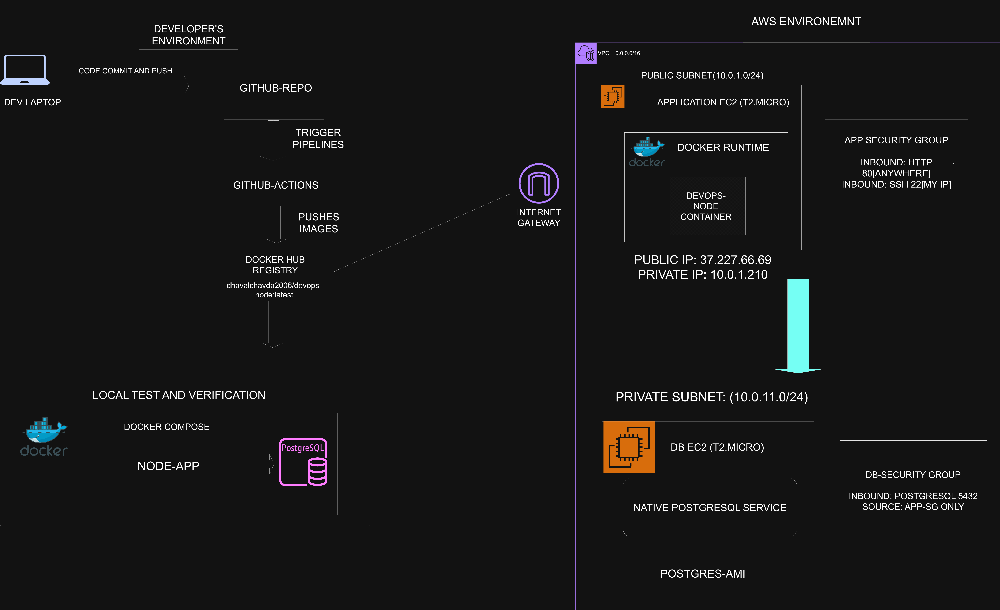

# Docker & AWS VPC Deployment

## 1. Project Overview
A hands-on DevOps project focused on containerizing a Node.js application with Docker and deploying it on AWS EC2 within a custom VPC. The project focuses on application deployment, network security, and troubleshooting.

## 2. What I Implemented
Containerized the Node.js application, managed dependencies and build context, and practised container operations and troubleshooting. On AWS, configured VPC networking, public and private subnets, route tables, and Security Groups to control traffic.

## 3. Technology Choices
- **Docker:** Consistent application environment and simplified deployment.
- **EC2:** Compute environment for hosting the application.
- **AWS VPC:** Network isolation and control over routing and IP addressing.
- **Security Groups:** Restrict inbound and outbound traffic.
- **PostgreSQL:** Practise database connectivity and private access, if included in the completed deployment.

## 4. Problem Solved
Addressed practical deployment challenges involving application dependencies, container operation, network connectivity, and access control. The design separates public application access from private database access, reducing unnecessary exposure when implemented and verified.

## 5. Validation and Learning
Documented deployment tests, network connectivity checks, Security Group behaviour, and troubleshooting scenarios. The project demonstrates practical understanding of containerization, AWS networking, security boundaries, and deployment decisions.

## Validation

Docker container running successfully:
 

**Repository:** https://github.com/dhaval-chavda2006/Week01-Devops
